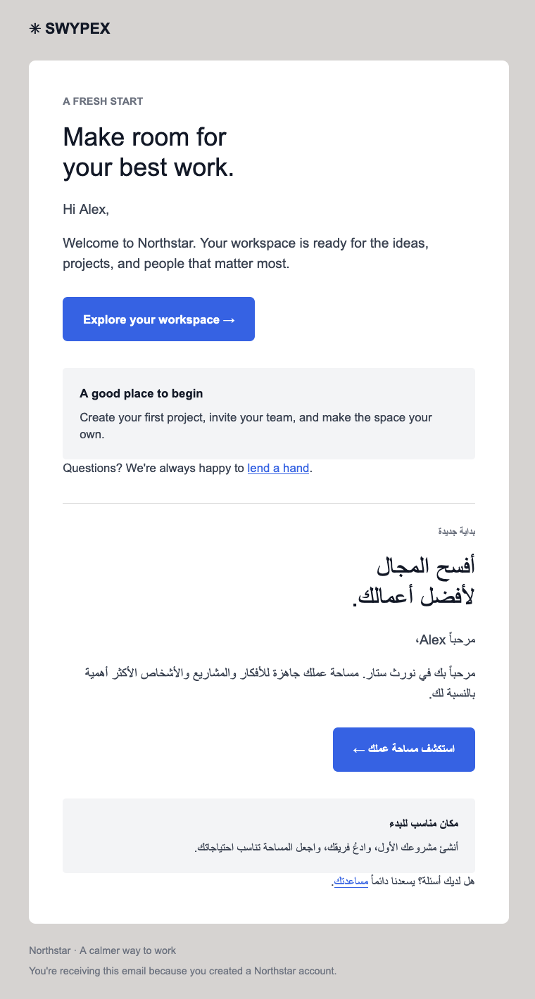
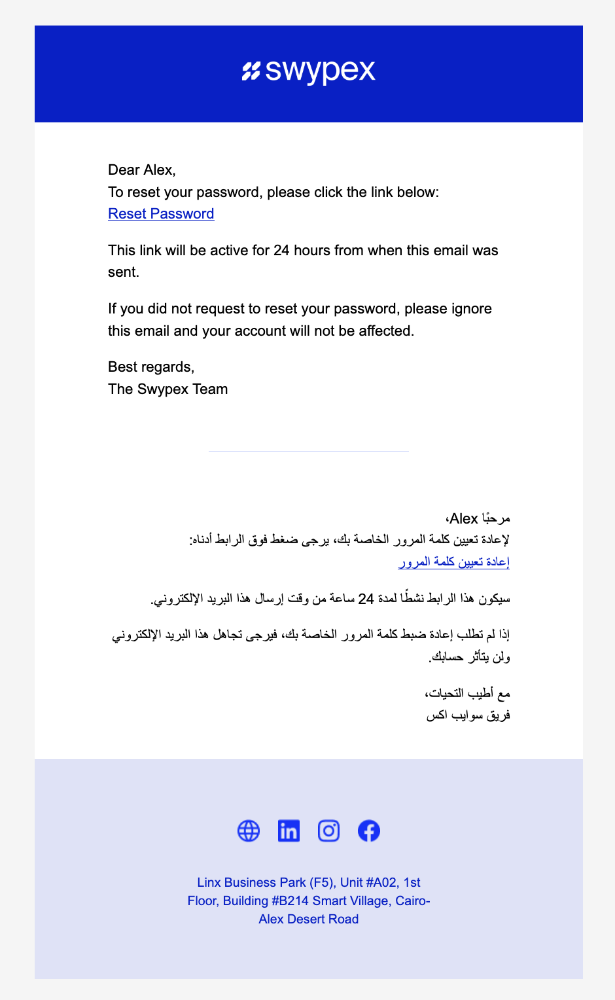

# Swypex Kotlin Emailx

A Kotlin native library helping with building beatiful emails easily. Emailx provides
reusable components that are well tested across different clients to ensure result
is rendered properly on all devices.

We also introduce Tailcss, a small (and naive) subset of [Tailwind](https://www.tailwindcss.com) CSS utility library
which can be used to style your emails.

This library was heavily inspired by amazing work done by [React Email](https://react.email/) team.

## Installation

```kotlin
implementation("com.swypex:emailx:0.1.0")
```

## Example Usage

```kotlin
import com.swypex.emailx.email
import com.swypex.emailx.components.*

val welcome = email("bg-gray-100", "font-sans") {
    container {
        heading("text-2xl", "font-bold") { +"Welcome!" }
        paragraph { attributes["emailx-in-text"] = ""; +"Your account is ready." }
        button("bg-blue-600", "text-white", href = "https://example.com") {
            attributes["emailx-in-text"] = ""
            +"Get started"
        }
    }
}

val html = welcome.toHtml()
val text = welcome.toText()
```

Emailx extends the [kotlinx.html DSL](https://github.com/Kotlin/kotlinx.html), so you can use
standard HTML elements alongside Emailx components anywhere they are valid in the surrounding
HTML. For example, import `kotlinx.html.*` and use `strong { +"ready" }` inside a `paragraph`.

## Plain-text output

`toText()` includes only elements marked with the `emailx-in-text` attribute. Marking an
element includes its descendants; nested marked elements are rendered once. Text is collected directly
as the template is built, without interpreting links, images, or layout. Use `email(text = "...")`
to provide an explicit text body instead.

```kotlin
paragraph {
    attributes["emailx-in-text"] = ""
    +"Your account is ready."
}
```

An unmarked template produces an empty generated text body, so mark the content you want readers
of plain-text email to receive.

## Example Render
Produced by running `./gradlew :example:run`

 

More examples can be run using gradle to see what they look like.

Run `./gradlew :example:passwordReset` for a real example of Swypex password reset email.

## Color scheme

Use `email(colorScheme = ColorScheme.LIGHT_ONLY) { ... }` to opt out of Gmail's
forced dark recoloring where supported.

## Integration with Kotlinmailer

Add [Kotlinmailer](https://github.com/BierDav/Kotlinmailer) to send the rendered email over SMTP:

```kotlin
dependencies {
    implementation("at.quickme.kotlinmailer:core:2.0.0")
    implementation("at.quickme.kotlinmailer:smtp:2.0.0")
}
```

Using `welcome` from the example above:

```kotlin
import at.quickme.kotlinmailer.delivery.send
import at.quickme.kotlinmailer.email.emailBuilder
import at.quickme.kotlinmailer.smtp.smtpMailer

suspend fun sendWelcome(smtpUser: String, smtpPassword: String) {
    val mailer = smtpMailer("smtp.example.com") {
        credentials(smtpUser, smtpPassword)
    }
    try {
        val message = emailBuilder {
            from("hello@example.com")
            to("alex@example.com")
            subject = "Welcome!"
            html = welcome.toHtml()
            text = welcome.toText()
        }
        message.send(mailer)
    } finally {
        mailer.close()
    }
}
```

Licensed under the Apache License, Version 2.0; see [LICENSE](LICENSE).
